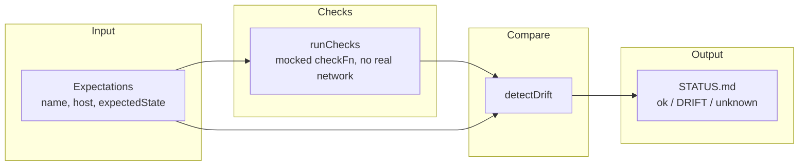

# Status-Ledger Pattern Demo

A small, dependency-free demonstration of generating a **`STATUS.md` as single source of truth** from a set of service checks, with explicit **drift detection** between expected and observed state.

## What & why

Distributed systems accumulate implicit assumptions about "what's supposed to be running". This pattern makes those assumptions explicit and machine-checkable:

1. Declare **expectations** for each fictional service (name, host, expected up/down state).
2. Run **checks** (here: fully mocked — `runChecks` never makes a real network call; it delegates to an injected `checkFn` so behavior is deterministic and testable).
3. **Compare** expected vs. observed (`detectDrift`) and classify each service as `ok`, `drift` (mismatch), or `unknown` (no observation at all).
4. **Render** the result as a `STATUS.md` markdown table — a durable, readable ledger of the system's believed state, not just a transient log line.

Example hosts use `192.0.2.x` (RFC 5737 documentation range) — these are placeholders, not real infrastructure.

## Pattern diagram



## Quickstart

```
node cli.js            # all services match expectation -> "all clear" STATUS.md
node cli.js --drift    # simulates batch-worker unexpectedly down -> DRIFT row
```

Output is printed to stdout and written to `STATUS.generated.md` (gitignored — it's a generated artifact, not source).

## Test command

```
node --test
```

## Verified

Ran `node --test` in this folder on 2026-09-29 (Node v24.19.0, this machine):

```
✔ detectDrift marks matching expectation/observation as ok
✔ detectDrift marks a mismatch as drift
✔ detectDrift marks a service with no observation as unknown
✔ runChecks never performs a real network call; it delegates to the injected checkFn
✔ end to end: a mocked drift scenario produces exactly one drift row
✔ renderStatusMarkdown produces a markdown table with a summary line
✔ renderStatusMarkdown reports all-clear when everything matches
tests 7, pass 7, fail 0
```

No real network calls are made anywhere in this demo — `runChecks` always takes an injected check function, and the CLI's `mockCheck` returns simulated results only.

## Fictional

This is a **fictional, from-scratch reimplementation of a general software pattern** (expectation/observation reconciliation rendered as a markdown status ledger). The three example services (`web-frontend`, `batch-worker`, `legacy-archiver`) and their `192.0.2.x` hosts are invented placeholders for this demo. It does not contain, reference, or derive from any specific proprietary codebase, real service names, real IP addresses, or real infrastructure.
